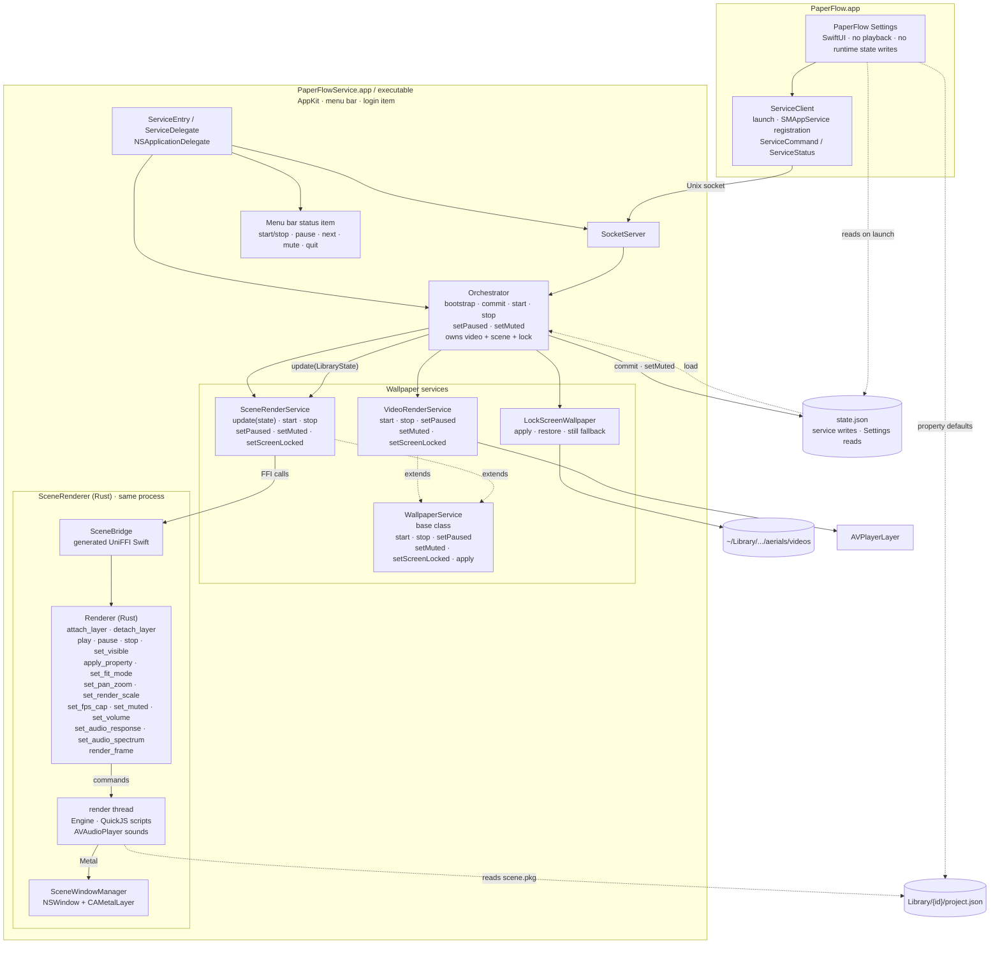

# Architecture

PaperFlow is one app bundle with two running processes:

- **PaperFlow.app** — the SwiftUI Settings app. It reads the library, edits settings, drives Steam Workshop downloads and sends commands to the service. It never plays a wallpaper and, after the one-time schema migration described below, never writes `state.json`.
- **PaperFlowService.app** — the nested AppKit background service at `Contents/Library/LoginItems/`. It owns playback, the lock screen, rotation timers, the menu bar item, the Unix socket and `state.json`.

The Rust/C++ scene renderer is statically linked into the service and accessed in-process through UniFFI. There is no scene-host process, no XPC service and no per-scene subprocess.

## Combined diagram

The outer graph is vertical; the app, playback services and renderer use horizontal layout. This is one diagram rather than separate process, class and Rust diagrams.



## Processes and IPC

Settings starts the nested service with `NSWorkspace.openApplication` when nothing answers on the socket, and registers it as an `SMAppService` login item. The service also enforces a single running instance: if a live service answers on the socket, a second copy exits.

The transport is a Unix domain socket, not NSXPC or launchd:

- Preferred path: `~/Library/Application Support/LiveWallpaper/service.sock`.
- Fallback when the path exceeds `sockaddr_un.sun_path`: `/tmp/lw-<uid>/service.sock`.
- Socket permissions are `0600`.
- Each message is a 4-byte big-endian length followed by JSON for `ServiceEnvelope`.
- The envelope carries a `ServiceCommand` or `ServiceStatus` payload encoded as JSON, so adding a command does not change the framing.
- One connection thread reads commands per client; commands are dispatched on the main actor; connected clients receive status pushes.

NSXPC was not used because launchd would not spawn the ad-hoc-signed nested service (`spawn failed, EX_CONFIG`). The custom socket avoids that requirement.

### State ownership

| File | Owner | Purpose |
|---|---|---|
| `state.json` | Service (normal operation) | Library, selections, rotation, scene options and power settings. Settings reads it and sends `.commit`. |
| `agent.json` | Service | Resume state, Aerial backup records and lock-screen restore state. |
| `Library/{id}/lock-{W}x{H}.mov` + `.json` | Service (`LockSceneRecorder`) | A scene's lock-screen loop for one screen size, with the metadata that says when it is stale. |
| `Library/{id}/project.json` | Workshop import / user library | Scene description read by both Settings and the renderer. |

There is one deliberate exception to “the service writes `state.json`”: when the Settings app upgrades a schema-1 file, `StateStore.loadOrMigrate` copies it to `state.v1-backup.json` and performs the one-time schema-2 rewrite before connecting to the service. After that, all commits go through the service.

## Service classes

`WallpaperService` is the playback base class:

```text
WallpaperService
  start(item)
  stop()
  setPaused(Bool)
  setMuted(Bool)
  setScreenLocked(Bool)
  apply(RenderOptions)
```

`VideoRenderService` extends it and overrides `start`, `stop`, `setPaused`, `setMuted` and `setScreenLocked`. It owns AVPlayer-backed windows and uses `AVPlayerLayer`.

`SceneRenderService` also extends it and overrides `start`, `stop`, `setPaused`, `setMuted` and `setScreenLocked`, and adds:

```text
update(LibraryState)
```

It does not use the base `apply` path for scene settings; it pushes only changed values to the renderer, and applies the battery rule itself (on battery or in Low Power Mode: pause, or lower FPS and render scale). While the screen is locked the renderer draws nothing and its sounds stop. One scene runs at a time across all displays. When a playing scene has audio response on, it also runs `SystemAudioTap` (a Core Audio process tap, macOS 14.2+) and hands the spectrum to the renderer.

`LockScreenWallpaper` is separate from the playback hierarchy. It applies and restores Aerial files, and on macOS 15 produces a still image instead of a live video. A scene chosen for the lock screen is first rendered by `LockSceneRecorder` (a second, off-screen `Renderer` at the screen's size, 10 s at 30 fps, HEVC) into `LockRenderCache`.

`Orchestrator` owns one `VideoRenderService`, one `SceneRenderService` and one `LockScreenWallpaper`, with separate desktop and lock-screen channels. It decides which service shows which item, handles rotation and failure fallback, and is the normal writer of `state.json`.

`ServiceDelegate` owns the socket server, the menu bar item and the orchestrator. Settings has no playback classes and never imports `SceneBridge`.

## Scene renderer

`SceneRenderer/` is our own MIT renderer (Rust + Metal). `scripts/build-scene-renderer.sh` builds `libscene_renderer.a` and runs `uniffi-bindgen` to generate:

- `Sources/SceneBridge/SceneRenderer.swift` — generated Swift API; do not hand-edit.
- `Sources/SceneBridge/FFI/scene_rendererFFI.h` and `module.modulemap` — the SwiftPM system-library target `SceneRendererFFI`.

The exported type is `Renderer` in `SceneRenderer/src/api.rs`. Every call is a message to the renderer's own thread, which owns the Metal device, the scene and its textures; calls never block on drawing (except `render_frame`, which returns pixels). Inside:

- `vfs`, `tex`, `scene`: the package, textures and `scene.json`.
- `shader`: Wallpaper Engine shaders to MSL through naga.
- `engine`: the frame graph (layers, effects, particles, puppets, text, bloom, fit modes).
- `script` + `script_prelude.js`: SceneScript on QuickJS (`rquickjs`).
- `sound`: sound objects through AVAudioPlayer.

`VideoRenderService` uses AVPlayer, not the renderer.

## Scene options and state

`LibraryState` stores:

- `sceneOptions: [String: SceneOptions]` — per-scene fit, zoom, pan, render scale, FPS override, volume, audio response and property overrides, keyed by the Swift item UUID.
- `power: PowerOptions` — global frame-rate cap, battery mode, battery render scale/FPS, `skipRepeatedFrames` and `renderOnlyOnChange`.

`SceneRenderService.update` compares the new values with the last pushed values and calls only the changed renderer methods.

| UI / model | Renderer call |
|---|---|
| Fit | `set_fit_mode` |
| Zoom, pan | `set_pan_zoom` |
| FPS, frame-rate cap, battery FPS | `set_fps_cap` (the smallest that applies) |
| Render scale, battery render scale | `set_render_scale` |
| Volume / mute | `set_volume` / `set_muted` |
| Audio response | `set_audio_response`, plus `set_audio_spectrum` from `SystemAudioTap` |
| Scene properties | `apply_property` (JSON value) |
| Battery rule "Pause", app pause | `pause` / `play` |
| Skip repeated frames, update only when changed | nothing: a scene in which nothing moves is never redrawn |

Settings reparses `Library/{id}/project.json` for the property editor (`SceneProperty.load`); it supports bool, slider, color, text and combo.

Known mismatches:

- `antialiasing` is stored in `SceneOptions` but is not applied or exposed in the current Settings UI.
- All displays show the same scene; per-display scene assignments are not implemented in Settings.

## Build and packaging

Build order:

```sh
./build.sh
```

`build.sh` runs `scripts/build-scene-renderer.sh` first (Rust stable, `MACOSX_DEPLOYMENT_TARGET=15.0`, `UNIVERSAL=1` merges an x86_64 slice with `lipo`), then builds the two Swift products. The renderer is a static library and uses only system frameworks, so nothing is bundled next to the service.

`Package.swift` declares macOS 14, the API floor the UI is written against (`swift-tools-version 5.9` has no `.macOS(.v15)`, and raising the tools version would switch every target to Swift 6 language mode). Both `Resources/Info.plist` files advertise `LSMinimumSystemVersion` 15.0, the install floor: the renderer's 15.0 deployment target is what makes the documented minimum macOS 15, so the bundle must not claim lower.

CI uses `macos-26` for build and release (its SDK has the Core Audio tap API).

`build.sh` assembles the Settings app, nests the service under `Contents/Library/LoginItems/` and signs inner bundles before the outer app. The guards reject SwiftUI or the old in-repo scene engine in the service, the old scene engine in Settings, and any Homebrew load path; `scripts/verify-bundle.sh` also checks that the renderer is linked into the service.

## Limitations

- Scene support is still partial: unsupported shaders, 3D models and lights, and video textures are reported as load warnings.
- The Swift scene property editor covers bool, slider, color, text and combo.
- Antialiasing is stored but not applied.
- All displays show the same scene.
- Video playback uses AVPlayer windows, while scenes use the Rust renderer.
- The app is ad-hoc signed and not notarized.

## Licensing

All code, including `SceneRenderer/`, is MIT-licensed under the root `LICENSE`. `SceneRenderer/NOTES.md` records which outside projects informed which parts of the renderer.
