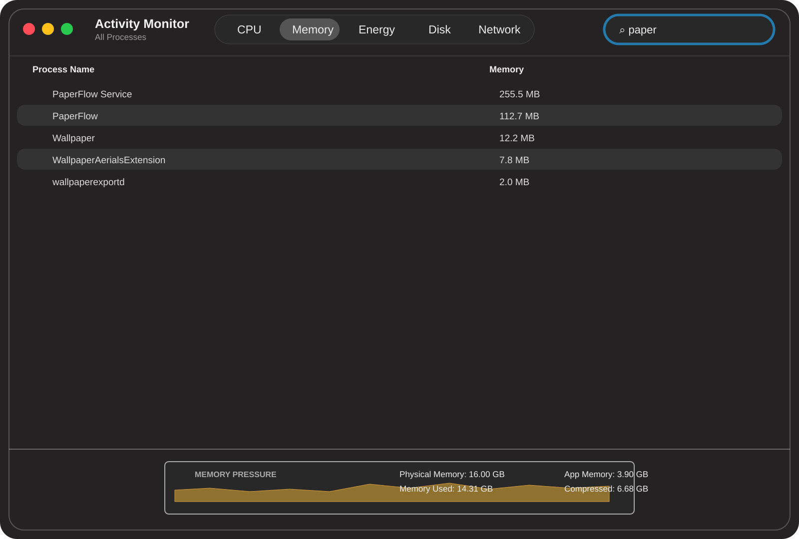

# Live Wallpaper for macOS: video and Wallpaper Engine wallpapers, rendered with Rust + Metal


[](https://github.com/NOOB-3301/LiveWallpaper/actions/workflows/build.yml)
[](../../releases)
[](LICENSE)


**Live Wallpaper** is a free, open-source animated wallpaper app for macOS. It plays videos and **Wallpaper Engine scenes** as your desktop wallpaper, rotates through a playlist on a timer, plays video on the lock screen (macOS 26+), and downloads wallpapers from the **Steam Workshop** with your own Steam account. Scenes are drawn by our own Rust + Metal renderer that sleeps when nothing is moving, so it stays light on battery.


## Resource Usage

The following Activity Monitor snapshots show the memory footprint of the wallpaper processes in two common usage scenarios:




## Features

- **Video wallpapers**: drop in MP4, MOV or M4V files; they play muted (or with sound) and loop on every display.
- **Wallpaper Engine scenes on a Mac**: a from-scratch renderer for `.pkg` scene packages: layers, effects, bloom, particles, puppet animation, text, parallax, SceneScript (QuickJS) and audio-reactive properties.
- **Steam Workshop browser**: browse Trending wallpapers, search, or paste a Workshop link; download with Valve's official SteamCMD and your own account.
- **Desktop and lock screen**: set them separately or together. Live lock-screen video on macOS 26; on macOS 15 a still frame of the current video.
- **Rotation**: cycle a playlist or your whole library every N seconds (minimum 5), independently for desktop and lock screen.
- **Battery-friendly**: frame-rate cap, render scale, "pause on battery", "skip repeated frames", "update only when the scene changes", pause while the screen is locked or the desktop is covered.
- **Menu bar control**: start/stop, pause, next wallpaper, mute and quit from a background service that keeps running after Settings closes.
- **Native and small**: SwiftUI settings app plus an AppKit background service. No Electron, no web view, no Homebrew libraries.

## Screenshots

| | |
|---|---|
|  |  |
| **Workshop browser.** Trending, search and a Mature filter. Web wallpapers are flagged as unsupported instead of failing after download. | **Paste a link.** Any Workshop URL or item number is looked up automatically and shows type, resolution, rating and size before you download. |
|  |  |
| **Steam Setup.** Three steps: install SteamCMD (about 3 MB), sign in, check Wallpaper Engine. | **Library.** Drop videos anywhere on the window. Sidebar filters: All, Desktop, Lock Screen, Scenes. |

## How the renderer works

Video wallpapers use `AVPlayer`. Wallpaper Engine scenes use our own renderer in [`SceneRenderer/`](SceneRenderer/): a Rust library that draws into one `CAMetalLayer` per display, linked statically into the background service and called through [UniFFI](https://github.com/mozilla/uniffi-rs) (no helper process).

### The render loop

The renderer owns one thread, the Metal device and the scene. Swift only sends messages; calls never wait on drawing.

```
Swift service ──commands──▶ channel ──▶ render thread
 (play, pause, fps, scale,              │
  properties, pointer, …)               ├─ idle?  block on recv()          → 0 % CPU
                                        └─ drawing? recv_timeout(next tick)
                                              └─ frame(): update → encode → present
```

- **Draws only when needed.** A tick happens only if the scene is `playing`, `visible`, has at least one target, and is animated, changed, or the pointer is held. A still scene, a covered desktop or a paused wallpaper blocks on the channel and costs nothing.
- **Fixed cadence, no bursts.** Ticks are scheduled `1/fps` apart. After a stall (Space switch, busy window server) the schedule restarts from now instead of firing a burst of catch-up frames.
- **Steady motion.** When a frame is on time, the scene clock advances by exactly one period, so wake-up jitter never shows as uneven movement. Late frames use the real delta, capped at 250 ms.
- **No queue lag.** If two frames are still waiting to be presented, the next tick is skipped so the queue drains and the picture never trails the pointer.
- **One command buffer for all displays.** Every screen is encoded into one buffer per frame, with transient targets pooled and reused inside the frame.
- **Parallax with the scene's own delay.** The pointer is eased toward its position using the scene's configured delay rather than jumping.
- **Power rules in the service.** The effective frame rate is the smallest of the scene setting, the frame-rate cap and the battery FPS; render scale and pause-on-battery apply the same way. Only changed values reach the renderer. While the screen is locked, nothing is drawn and sounds stop.
- **Lock screen scenes.** A second off-screen renderer records a 10 s, 30 fps HEVC loop at the screen's size and caches it, so the lock screen plays a video instead of a live GPU scene.

### Shader pipeline: GLSL 1.20 to Metal

Wallpaper Engine shaders are HLSL-flavoured GLSL 1.20. They are translated at load time and cached on disk by source hash, so a scene compiles once.

```
WE shader (GLSL 1.20)
   │  Rust rewriter (SceneRenderer/src/shader.rs)
   │    • inline #include, apply [COMBO] values and uniform JSON annotations
   │    • attribute / varying / uniform / sampler2D → explicit-binding declarations
   │    • patch HLSL-only constructs (implicit conversions, mixed-size multiplies, inverse)
   ▼
GLSL 4.50
   │  naga  (glsl-in → validate)
   ▼
naga IR
   │  naga  (msl-out)
   ▼
Metal Shading Language ──▶ Metal pipeline
```

See [ARCHITECTURE.md](ARCHITECTURE.md) for the process, IPC and bridge diagram.

## Install

1. Download `LiveWallpaper-<version>.dmg` from the [Releases](../../releases) page. Optional: check it with `shasum -a 256 -c LiveWallpaper-<version>.dmg.sha256` in the same folder.
2. Open the DMG and drag **LiveWallpaper** onto the **Applications** shortcut.
3. First launch. The app is signed ad hoc and **not notarized** (there is no paid Apple Developer account behind this project), so macOS blocks a downloaded copy the first time. Do one of these once:
   - Try to open it, then go to **System Settings > Privacy & Security**, scroll to the message about "LiveWallpaper", and press **Open Anyway**.
   - Or, in Terminal: `xattr -dr com.apple.quarantine /Applications/LiveWallpaper.app` (this also covers the nested service).
4. macOS may ask for access to your Desktop, Documents or Downloads folder, once for the Settings app and once for the background service (the service is what reads your videos and scenes).

## Usage

- Add videos by dropping them on the window or with Add Videos (⌘O). The first item is selected automatically.
- The preview shows the selected item, muted and looping.
- **Set as Desktop**, **Set as Lock Screen** or **Set as Both** assigns the selected item. Scenes can only be used on the Desktop; the lock screen needs a video.
- Rotation cycles through the playlist, or the library when no playlist is set, in list order. Set how often it switches (minimum 5 seconds). Rotation needs at least two wallpapers.
- **Same for both** (on by default) shares the selection and rotation settings between Desktop and Lock Screen. Turn it off to configure them separately.
- **Start Wallpaper** (⌘↩) starts the service if needed and begins playback. **Stop Wallpaper** ends playback and restores your original wallpapers.
- The service's menu bar item offers Open Settings, Start/Stop, Pause/Resume, Next Desktop Wallpaper, Next Lock Screen Wallpaper, Mute and Quit.
- Closing the Settings window quits Settings; the service keeps playing. Choosing Quit Wallpaper restores Apple's wallpapers and stops the service.

Everything the app installs stays in `~/Library/Application Support/LiveWallpaper/` and `~/Library/Caches/LiveWallpaperSteam/`. Remove the app and those folders to uninstall; choose **Quit Wallpaper** in the menu bar first so Apple's original wallpapers are restored.

## Requirements

- macOS 15 or later on Apple silicon.
- Live lock-screen video on macOS 26 or later. On macOS 15 the lock screen uses a still frame of the current video instead.
- To build from source: macOS 26 with Xcode 26 or matching Command Line Tools, and Rust stable (rustup). No Homebrew libraries are needed.

Release builds are arm64. `UNIVERSAL=1 ./build.sh` adds an x86_64 slice (it needs `rustup target add x86_64-apple-darwin`).

## Build and run

```sh
./build.sh
open build/LiveWallpaper.app
```

`build.sh` first runs `scripts/build-scene-renderer.sh`, which builds the scene renderer (`SceneRenderer/target/release/libscene_renderer.a`) and regenerates its UniFFI Swift bindings in `Sources/SceneBridge`. It then builds the two Swift products and assembles `build/LiveWallpaper.app` with `LiveWallpaperService.app` nested at `Contents/Library/LoginItems/`, and signs both ad hoc.

Run the app through the `.app` bundle. `swift run` does not work, because both products need their `Info.plist`.

Useful options:

- `CONFIG=debug ./build.sh` builds a debug variant.
- `VERSION=1.2.3 BUILD_NUMBER=45 ./build.sh` stamps a version into both bundles.
- `swift test` runs the Core and SceneFormat tests after the renderer has been built.

The build checks that Settings never links the old scene engine and that the service never links SwiftUI or the old in-repo scene engine. The service does link Metal and `SceneBridge` for scenes.

`scripts/make-dmg.sh build/LiveWallpaper.app 1.2.3` packs the app into `dist/LiveWallpaper-1.2.3.dmg` with an Applications shortcut and a SHA-256 file. Pushing a tag such as `v1.2.3` runs the `release` workflow on a macOS 26 runner and attaches the DMG to a GitHub Release.

## Architecture

Two processes: the SwiftUI **LiveWallpaper** (Settings) app, which plays nothing, and the nested AppKit **LiveWallpaperService**, which owns playback, the lock screen, rotation timers, the Unix socket and `state.json`. Settings sends commands to the service over the socket and never imports `SceneBridge`. The Rust renderer is statically linked into the service, not a separate process. Full diagram, state ownership and option mapping: [ARCHITECTURE.md](ARCHITECTURE.md).

## FAQ

**Does Wallpaper Engine work on Mac?** Not officially. Live Wallpaper plays Wallpaper Engine *video* and *scene* wallpapers natively on macOS. Web and application wallpapers are not supported.

**Do I need Wallpaper Engine or Steam?** Local videos need neither. Workshop downloads use Valve's SteamCMD with your own Steam account, and the Steam Setup page walks you through it.

**Does it drain the battery?** Videos use `AVPlayer`. Scenes only render while something changes, and you can cap FPS, lower render scale or pause on battery.

**Can I use a live wallpaper on the lock screen?** Yes, with a video on macOS 26 or later. Scenes are baked into a short looping video first. On macOS 15 you get a still frame.

**Why does macOS warn about the app?** It is signed ad hoc, not notarized. See [Install](#install).

## Disclaimer

Not affiliated with Valve or Wallpaper Engine. Downloads use Valve's own SteamCMD with your own account, for personal use on your Mac. Workshop items belong to their creators; do not redistribute them.

## License

[MIT](LICENSE)
