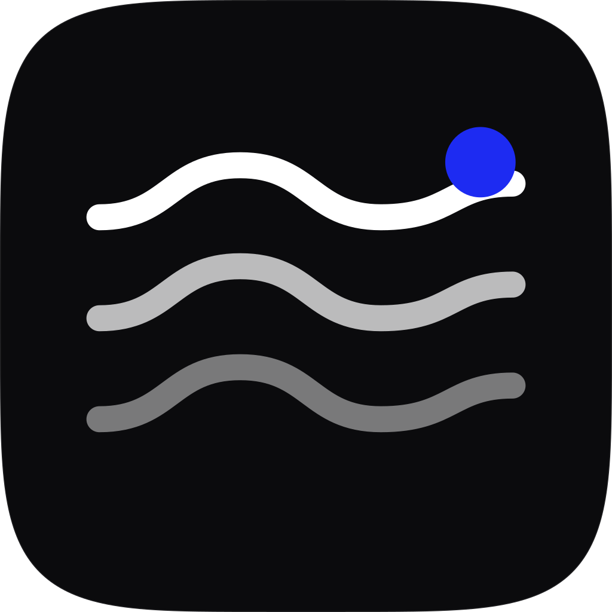

# App icon

The app icon is the same **wave mark** used on the website: three pale waves on a near-black squircle,
with a blue signal dot above the top wave.



## Files

- `app-icon.svg` — the source (1024 x 1024, macOS squircle). **This is the master copy.**
- `../tools/svg2png.swift` — the renderer used to export it (WebKit; no design tools needed).
- `../../Resources/AppIcon.icns` — the shipped icon, built from `app-icon.svg` and copied into the
  Settings app bundle by `build.sh` (`CFBundleIconFile` = `AppIcon` in `Resources/Info.plist`).
  The two helper apps (agent, scene host) deliberately keep the generic macOS placeholder.

Only the vector is committed; the `.icns` is a build artefact that `build.sh` copies in.

## Regenerating the icon

```sh
# render every size into an iconset
mkdir /tmp/ic.iconset
for spec in "icon_16x16:16" "icon_16x16@2x:32" "icon_32x32:32" "icon_32x32@2x:64" \
            "icon_128x128:128" "icon_128x128@2x:256" "icon_256x256:256" "icon_256x256@2x:512" \
            "icon_512x512:512" "icon_512x512@2x:1024"; do
  file="${spec%%:*}"; px="${spec##*:}"
  swiftc -O tools/svg2png.swift -o /tmp/svg2png
  /tmp/svg2png assets/logos/app-icon.svg "/tmp/ic.iconset/$file.png" "$((px/2))" "$((px/2))"
done
iconutil -c icns /tmp/ic.iconset -o Resources/AppIcon.icns
```

The renderer draws at 2x the requested points, so a 1024 px PNG is requested as `512 512`.

## Tweaking

- The waves are the three `M166.4 …` paths. Their stroke width is `43.52`, with opacities `1`, `0.72`
  and `0.45` from top to bottom.
- The blue dot is the `#1d2bf2` circle at `803.84, 271.36` with radius `58.88`.
- The tile is `#0b0b0d` inside a superellipse (exponent 5) inscribed in the 1024 canvas. Keep the
  artwork inside it and avoid detail that disappears below 32 px.
